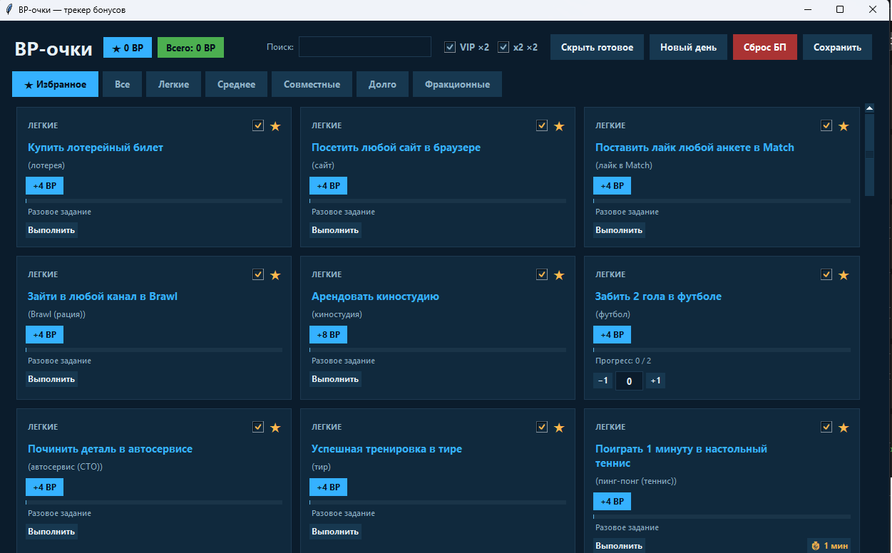
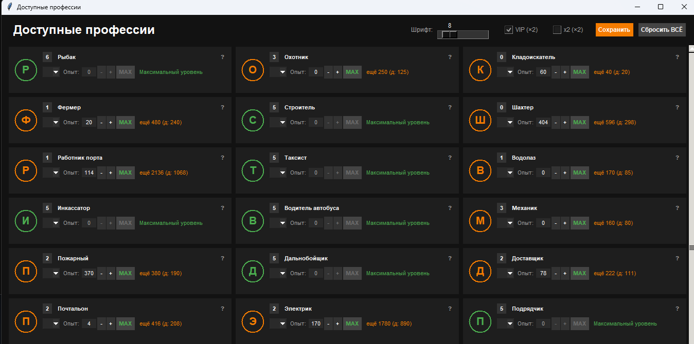
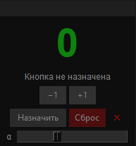

# 🎮 Python GTA5 Tools

Набор полезных офлайн-приложений на Python (Tkinter) для игроков в GTA5 (RP-серверы). 
Все инструменты работают локально, не требуют подключения к интернету и используют только стандартную библиотеку Python (кроме оверлея).

## 📦 Включенные приложения

### 1. 📘 [BP-очки — трекер бонусов](./БП/bp.md)
**Файл:** `БП/bp.py`



Приложение для отслеживания ежедневных заданий и бонусных очков (BP).
- ✅ Учёт заданий по разделам (Легкие, Средние, Фракционные и др.)
- ⭐ Система «Избранного» для самых важных задач
- ➕ Поддержка многошаговых заданий (прогресс-бар)
- ⏱ Встроенные таймеры со звуковым сигналом
- 💰 Автоматический подсчёт с учётом множителей (VIP ×2, x2 ×2)
- 🔍 Поиск и фильтр «Скрыть готовое»

---

### 2. 📘 [Skills — трекер профессий](./Навыки/skill.md)
**Файл:** `Навыки/skills.py`



Трекер для прокачки профессий и уровней.
- 📊 Наглядный прогресс до следующего уровня
- 🔢 Автоматическое повышение уровня при достижении нужного опыта
- 🏆 Кнопка «MAX» для мгновенной прокачки
- 💰 Учёт глобальных множителей опыта (VIP, x2)
- 🔤 Регулировка размера шрифта
- ❓ Встроенная справка по каждой профессии

---

### 3. 📘 [Counter Overlay — счётчик](./Счетчик%20оверлей/counter_overlay.md)
**Файл:** `Счетчик оверлей/counter_overlay.py`



Полупрозрачный оверлей поверх всех окон для подсчёта кликов или нажатий клавиш.
- 🎯 Назначение любой клавиши или кнопки мыши
- 🔄 Работает поверх окон (удобно для игр)
- 🎚 Регулировка прозрачности (α)
- ➕➖ Ручная корректировка счёта
- 🖱 Перетаскивание за верхнюю панель

---

## 🚀 Установка и запуск

### Требования
- **ОС:** Windows (основная поддержка)
- **Python:** 3.8 или новее

### Установка зависимостей
Для приложений `bp.py` и `skills.py` **не требуются** сторонние библиотеки.
Для работы **счётчика-оверлея** (`counter_overlay.py`) необходимо установить библиотеку `pynput`:
```bash
pip install pynput
```

### Запуск
1. Скачайте репозиторий (кнопка `Code` -> `Download ZIP`) или склонируйте его:
   ```bash
   git clone https://github.com/pratorozon/python_gta5.git
   ```
2. Перейдите в папку с нужным приложением.
3. Запустите скрипт через командную строку:
   ```bash
   # Для BP-очков
   python bp.py
   
   # Для Навыков
   python skills.py
   
   # Для Счётчика
   python counter_overlay.py
   ```
   *Также можно создать ярлык `.bat` для удобного запуска, чтобы не открывать консоль каждый раз.*

---

## 📂 Структура репозитория

```text
python_gta5/
├── README.md                  # Этот файл (общее описание)
├── images/                    # Папка со скриншотами для главной страницы
│   ├── bp.png
│   ├── skills.png
│   └── counter_overlay.png
├── БП/                        # Приложение BP-очки
│   ├── bp.py
│   ├── bp.md                  # Инструкция к BP
│   └── bp_config.json         # (создается автоматически)
├── Навыки/                    # Приложение Skills
│   ├── skills.py
│   ├── skill.md               # Инструкция к Навыкам
│   └── skills_config.json     # (создается автоматически)
└── Счетчик оверлей/           # Оверлей-счётчик
    ├── counter_overlay.py
    └── counter_overlay.md     # Инструкция к Счётчику
```

---

## 💾 Сохранение данных

Приложения **BP-очки** и **Skills** автоматически сохраняют ваш прогресс в файлы конфигурации (`bp_config.json` и `skills_config.json`). 
- В «BP-очках» файл по умолчанию сохраняется в папке со скриптом (или в `%APPDATA%`, если нет прав на запись).
- В «Skills» файл сохраняется строго рядом со скриптом.
- **Оверлей-счётчик** не сохраняет данные (счёт сбрасывается при закрытии программы).

Подробнее о путях к файлам и резервном копировании читайте в инструкциях к конкретным приложениям (файлы `.md` в папках).

---

## ⚠️ Важно
- Приложения не являются читами и не вмешиваются в память игры. Они работают исключительно как внешние трекеры.
- Оверлей использует библиотеку `pynput` для перехвата нажатий клавиатуры и мыши. В онлайн-играх с агрессивными античитами использование подобных программ может быть расценено как стороннее ПО. **Используйте на свой страх и риск.**
```

### Что я поправил под твою структуру:
1. Ссылки на инструкции теперь ведут на те файлы, которые я вижу на скриншоте (`bp.md`, `skill.md`, `counter_overlay.md`). Обрати внимание, что в папке «Навыки» файл называется `skill.md` (а не `skills.md`).
2. Пути к картинкам указаны как `./images/...`.
3. В структуре папок я отразил реальные имена твоих файлов, чтобы README полностью соответствовал репозиторию. 
4. Ссылка на папку со счетчиком использует `%20` вместо пробела: `./Счетчик%20оверлей/...` — это обязательно для GitHub, иначе ссылка не сработает.
